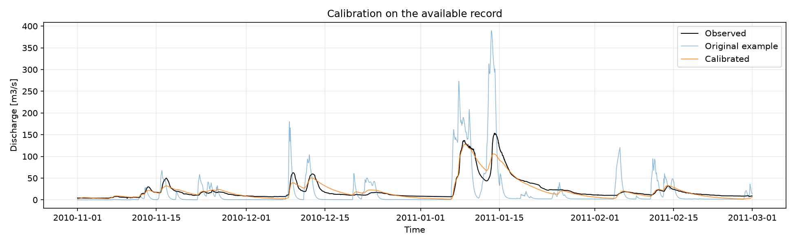

# MMUQ Assignment 1: HBV001a Calibration

Calibration of the supplied HBV001a rainfall-runoff model using SciPy Differential
Evolution (DE). The objective is `1 - NSE`. All evaluated parameter vectors and
their objective values are recorded, together with the running best objective.

## Results

DE converged after **263 generations** and **38,016 objective evaluations**.

| Metric | Original example | Calibrated |
|---|---:|---:|
| NSE | -1.050765 | 0.906972 |
| RMSE [m3/s] | 36.895747 | 7.858229 |

The full supplied record is used for calibration. No warm-up is excluded and no
independent validation performance is claimed. Convergence does not prove global
optimality or unique physical parameter identification.



- [Full report](calibration_outputs/assignment_report.md)
- [Best parameters](calibration_outputs/best_parameters.csv)
- [All parameter and objective evaluations](calibration_outputs/evaluation_history.csv)
- [Reading guide](START_HERE.md)

## Structure

```text
Assignment 1/
  ab_calibrate_hbv.py             Main calibration program
  calibration_config.py          Supplied bounds and optimizer settings
  calibration_report.py          Report generation
  ac_verify_results.py           Saved-result verification
  aa_run_hbv.py                  Original single-run demonstration copy
  hmg/                          Supplied HBV001a implementation
  Rainfall-Runoff Modelling Data/ Supplied forcing, observations and catchment files
  calibration_outputs/          Final report, parameters, histories and six figures
  references/                   Instructions and parameter-bound screenshot
  requirements.txt              Python package versions
  run_calibration.command       macOS launcher
  START_HERE.md                 Reading and running guide
  SHA256SUMS.txt                File-integrity checksums
```

The supplied model and input data are preserved. Calibration, tracking, plotting
and reporting are implemented around the supplied model interface.

## Run

Use Python 3.12. Open a terminal in this folder, then run:

```sh
python3 -m pip install -r requirements.txt
python3 ab_calibrate_hbv.py --check
python3 ab_calibrate_hbv.py
python3 ac_verify_results.py
```

The full run overwrites `calibration_outputs/`. Figures are saved as PNG files;
the program does not open plotting windows.

After installing the dependencies, macOS users can also run:

```sh
./run_calibration.command --check
./run_calibration.command
```

The launcher uses `python3` from the current environment. Set `PYTHON_EXECUTABLE`
to use a different interpreter. Paths to the model and input data are resolved
relative to the script, so this folder can be moved or cloned as a unit.

## GitHub upload

Upload this complete `Assignment 1` folder to the course repository, preserving
its subfolders. The report and README use relative links so their figures also
work on GitHub. Old ZIP backups and generated caches have been moved outside
this upload folder. `.gitignore` excludes them from future Git commits.

The `references/` folder contains the supplied course material. Additional
classroom requirements and Moodle submission rules should be checked against
the course page.
