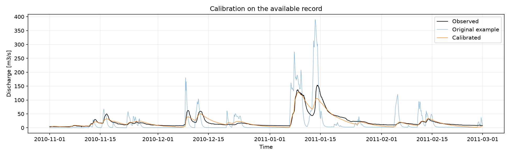
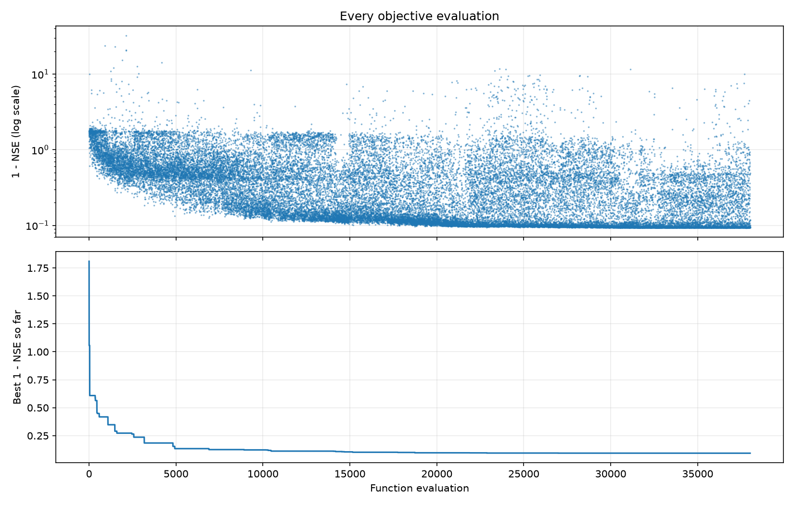
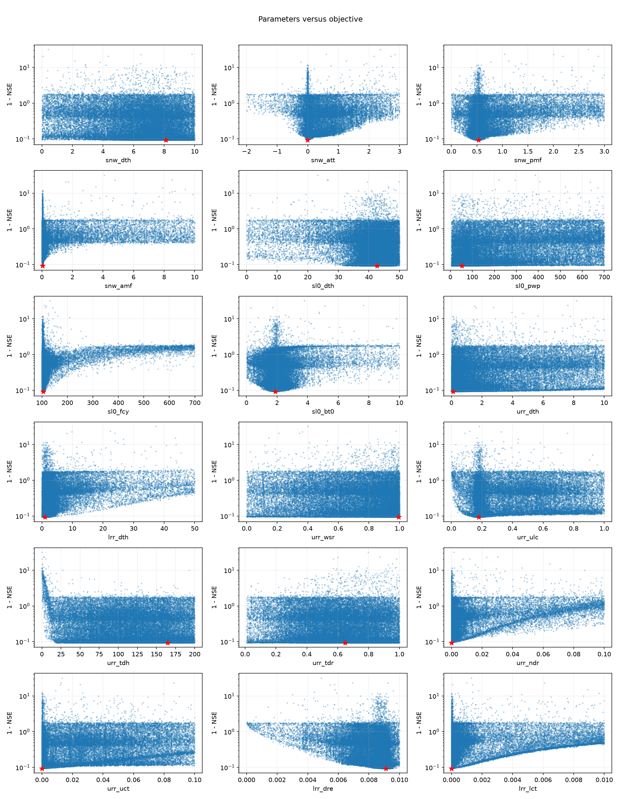
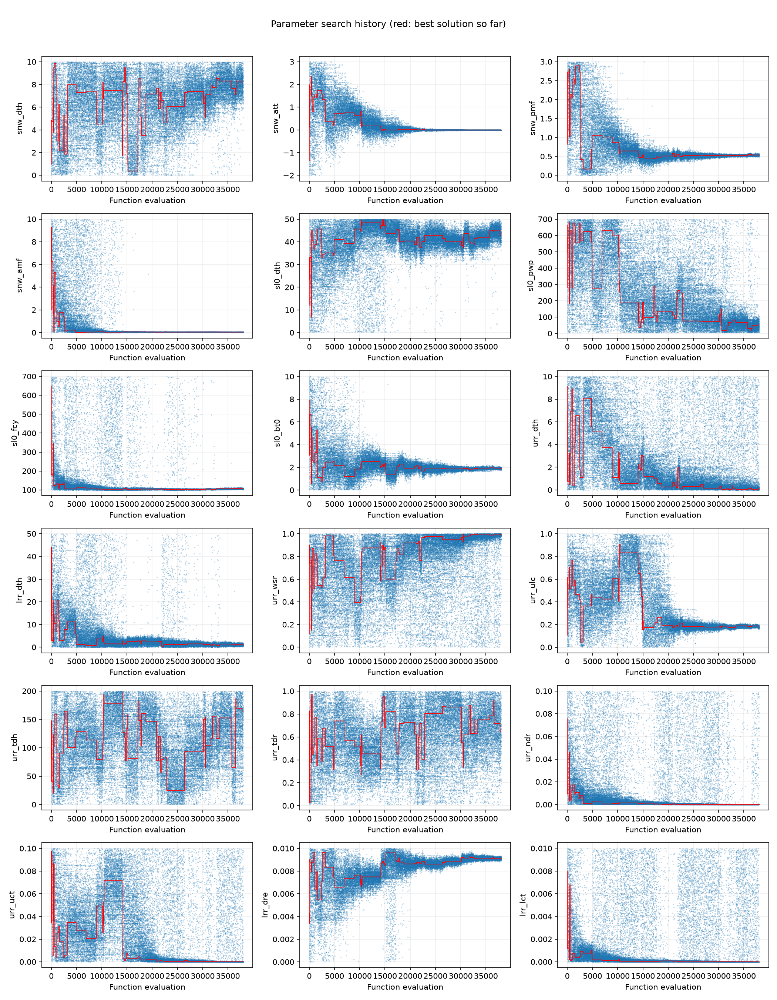
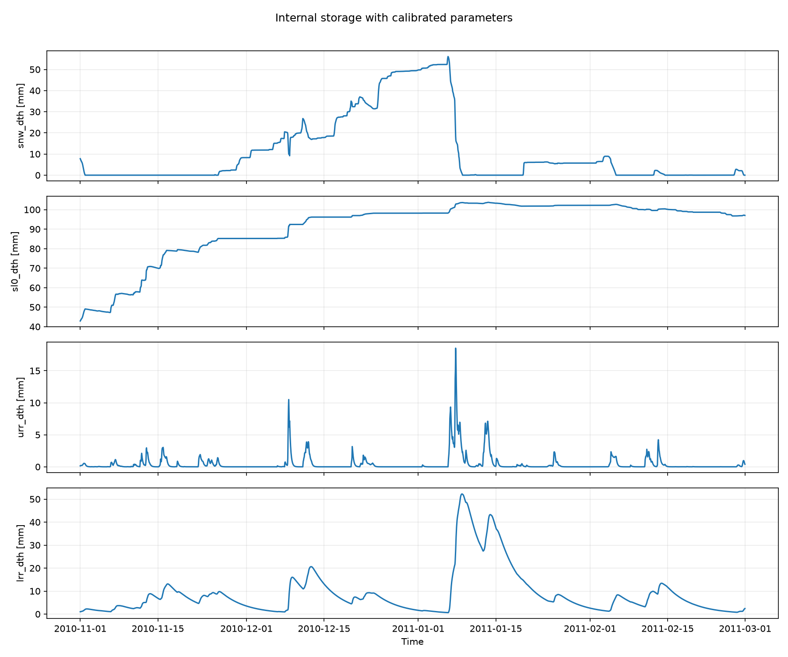
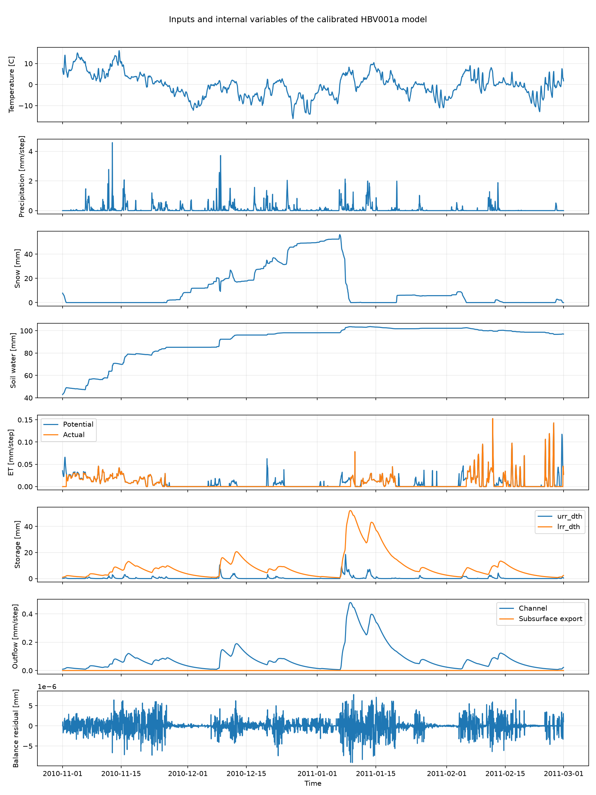

# MMUQ Assignment 01: Calibration of HBV001a

## 1. Aim and supplied material

The aim is to find a parameter vector that reproduces the supplied observed hydrograph
using HBV001a and SciPy Differential Evolution (DE). The model implementation is unchanged.
The 18 parameter bounds were transcribed by parameter name from the supplied Moodle
screenshot, `sketch (1).png`. This implementation uses the accompanying hourly record
and catchment area file. Input file SHA-256 hashes are stored in `run_summary.json`.

The record contains 2,880 hourly steps. The evaluation period is
2010-11-01 00:00:00 to 2011-02-28 23:00:00.
Catchment area is 959.0 km2.
Temperature, precipitation and potential evapotranspiration drive the model.
Observed discharge is used to evaluate its output, not as a forcing input.
Runoff depth in mm per hour is converted to m3/s using area / (1000 * 3600).

## 2. Objective function and repeatable model evaluation

For simulated discharge Qsim(theta) and observed discharge Qobs, define

J(theta) = 1 - NSE(theta)
         = sum((Qsim(theta) - Qobs)^2) / sum((Qobs - mean(Qobs))^2).

DE minimizes J. A perfect fit has J = 0 and NSE = 1. NSE = 0 corresponds to the
squared error of a constant prediction equal to the observed mean; NSE can be negative.
The observed denominator is calculated once on the evaluation period.

All 18 supplied parameter entries are included in the vector, including
four initial storages. Every candidate restarts the model from its own specified initial
storages. During optimization only the discharge series is needed. The best candidate
is rerun with full internal outputs for diagnostics. Mode consistency, restart behavior,
the objective formula, and copied history records are checked by `--check`.
The model casts parameters to float32; `best_parameters.csv` includes both the optimizer
values and the effective float32 values.

No warm-up is removed (0 steps), and the entire record is used for
calibration. There is no held-out validation period. These are explicit implementation
choices because the supplied written instructions do not specify a temporal split.
The reported performance therefore describes fitting this record, not predictive skill
on independent data. Squared errors emphasize larger discharge errors.

## 3. Optimization and stopping condition

The method is SciPy `differential_evolution`, strategy `best1bin`, with seed
42, population multiplier 8, Latin-hypercube
initialization, mutation interval (0.5, 1.0), recombination 0.7, immediate updating,
one worker, relative tolerance 0.001, absolute tolerance 0,
and a maximum of 3000 generations. Local polishing is disabled so
that the recorded search describes DE alone. These settings are implementation choices.

SciPy reports successful convergence under the population-spread criterion. The run used 263 generations and
38,016 objective evaluations in 203.0 seconds.
The final population objective standard deviation is
9.0950796e-05; its convergence threshold is
9.3219259e-05.
The check is std(population objective) <= atol + tol * abs(mean(population objective)).
Convergence measures agreement within this population; it does not prove global
optimality, parameter uniqueness, or physical identifiability. This is one seeded run.

Every objective call appends a copy of its parameter vector and objective value.
`evaluation_history.csv` contains the complete history, rather than only accepted
population members or per-generation best candidates. `generation_history.csv` contains
one summary per generation. The final population is saved in `final_population.npz`.

## 4. Results

| Metric | Original demonstration | Calibrated |
|---|---:|---:|
| NSE | -1.050765 | 0.906972 |
| RMSE [m3/s] | 36.895747 | 7.858229 |
| Mean bias [m3/s] | -3.482851 | -1.126684 |
| Volume bias [%] | -15.5658 | -5.0354 |

Positive bias means overestimation. The best objective value is
0.0930277795. The original demonstration is a before-calibration
reference only: some of its values lie outside the supplied calibration bounds, so it
was not used as DE's initial candidate and is not a feasible baseline for this search.

At the largest observed peak (2011-01-14 05:00:00), observed discharge is 153.50 m3/s and simulated discharge is 105.12 m3/s. These are compared at the same timestamp; the simulated maximum may occur at another time.

### Best parameter vector

| Parameter | Lower bound | Upper bound | Best optimizer value |
|---|---:|---:|---:|
| `snw_dth` | 0 | 10 | 8.12485437 |
| `snw_att` | -2 | 3 | -0.0062727709 |
| `snw_pmf` | 0 | 3 | 0.53256844 |
| `snw_amf` | 0 | 10 | 0.0431229834 |
| `sl0_dth` | 0 | 50 | 42.643555 |
| `sl0_pwp` | 5 | 700 | 52.2029553 |
| `sl0_fcy` | 100 | 700 | 105.45198 |
| `sl0_bt0` | 0.01 | 10 | 1.89682181 |
| `urr_dth` | 0 | 10 | 0.113816818 |
| `lrr_dth` | 0 | 50 | 1.0068972 |
| `urr_wsr` | 0 | 1 | 0.994174623 |
| `urr_ulc` | 0 | 1 | 0.178668332 |
| `urr_tdh` | 0 | 200 | 164.664265 |
| `urr_tdr` | 0.01 | 1 | 0.648295053 |
| `urr_ndr` | 0 | 0.1 | 2.38736514e-05 |
| `urr_uct` | 0 | 0.1 | 1.51544705e-05 |
| `lrr_dre` | 0 | 0.01 | 0.00910482521 |
| `lrr_lct` | 0 | 0.01 | 1.93903357e-06 |

Parameters within 1% of a supplied bound: snw_amf, sl0_fcy, urr_wsr, urr_ndr, urr_uct, lrr_lct.
A boundary result is reported without expanding the supplied search region.
It can reflect limited data, parameter trade-offs, or the chosen bounds and objective;
it does not alone establish that the physical parameter is known precisely.
Names and ordering follow the actual model interface; generic HBV parameter tables
and ambiguous screenshot comments are not used to redefine these parameters.

## 5. Search history and interpretation

The upper panel shows all attempted objective values. Individual trials can get worse
while the search improves. The lower panel shows the running minimum, which can only
decrease or remain constant. After the first candidate it improved
61 times; flat portions are intervals without a new best.
When every objective value is positive, the upper panel and parameter/objective scatter
plots use a logarithmic objective axis to show both poor trials and the better region.
No evaluations are discarded from the plots or the history table.

Each panel plots one parameter against the objective for every evaluated candidate.
The red star marks the final best vector. A low-objective region indicates values seen
in good sampled combinations, not an isolated causal effect of that parameter.
The plots are exploratory diagnostics rather than a formal sensitivity analysis or
a posterior distribution.

Blue points show all attempted parameter values in evaluation order; red lines show
the corresponding coordinate of the best vector found so far. Parameter coordinates
can move in either direction even though the best objective never increases.
Broad spread or a changing best coordinate can indicate weak constraint or trade-offs.

## 6. Internal diagnostics and limitations

All saved internal outputs finite: True.
Minimum simulated discharge: 1.5425457 m3/s.
Maximum absolute hourly water-balance residual:
9.0897083e-06 mm.
Small balance residuals check numerical conservation, not goodness of fit.
The supplied implementation's `get_discharge()` uses the channel outflow. Separate
subsurface exports are shown in the diagnostics and included by the supplied balance
calculation; this calibration retains that original discharge definition.

This solution covers the requirements in the supplied one-page instructions:
parameter-vector evaluation, DE with supplied bounds, an explicit objective, complete
PV/OFV tracking, parameter-versus-objective plots, parameter and objective trajectories,
the running best, and presentation of the final result. Submission format, deadline,
grading criteria and any additional classroom requirements were not supplied. They
are not invented here. This package is ready for review against those course details.

## 7. Reproduction and reading order

Use Python 3.12 and the package versions listed in `requirements.txt` in the parent
directory. From that directory run `python ab_calibrate_hbv.py --check`, then
`python ab_calibrate_hbv.py`. On macOS, `run_calibration.command` uses `python3`, or `PYTHON_EXECUTABLE` if set,
after dependencies have been installed. A full run overwrites the final output
directory. The earlier 100-generation backup is stored outside this upload folder.

Read `calibration_config.py` first, then `main()` in `ab_calibrate_hbv.py`, followed by
`load_data`, `create_model`, `simulate`, `make_objective` and `save_results`.
`calibration_report.py` formats this report. The supplied model and original
demonstration are preserved. No new forcing data or model parameters are fabricated.
